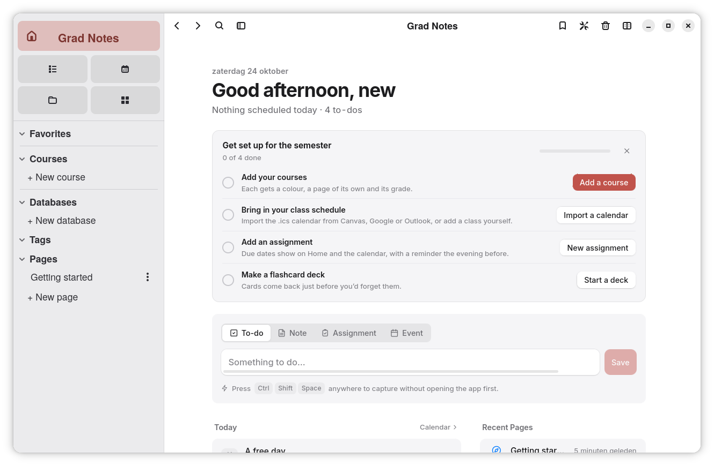

# Grad Notes

A local-first notes and study workspace with nested pages, a block editor, full-text search, databases, assignments, a calendar and a connected file library. The supported desktop app is built for **Linux** with **Rust, GTK 4, libadwaita, WebKitGTK, Svelte 5 and TypeScript**. It follows GNOME's native window and header bar conventions.

## Download

Download the Linux Flatpak from the [latest release](https://github.com/paullinux-gn/grad-notes/releases/latest). Open it with GNOME Software, or install it with `flatpak install --user ./Grad-Notes-0.5.8.flatpak`. Flatpak uses a separate workspace and does not import existing notes automatically.

Grad Notes currently supports Linux desktop environments. The native GTK 4/libadwaita shell is designed for GNOME and runs on Wayland and X11 through GTK/WebKitGTK. Windows and macOS builds are not supported.

## Screenshot



## Why it's light

- **Uses the system WebKitGTK web view** instead of bundling Chromium.
- **Tiny frontend runtime.** Svelte compiles to plain DOM code; the JS heap sits around 3–5 MB.
- **Only one editor is alive at a time.** Opening a page destroys the previous editor; the sidebar only loads page titles, never bodies.
- **Size-optimized release profile** (LTO, `opt-level = "s"`, stripped, `panic = "abort"`).

### Built for years of notes

Tested against a workspace of 7,500 pages (a 2 MB book among them), 2,000 files, 3,000 assignments and events, 11,000 open to-dos and 17,000 flashcards:

- **Bodies live apart from the page list.** Listing pages, counting and recent pages never read through page text.
- **Links, to-dos and flashcards are indexed on save.** Backlinks, file usage, Home and the flashcard counts are lookups, not a parse of every page (file usage went from 92 s to 7 ms).
- **Storage work never runs on the UI thread,** so a slow query can't freeze the window.
- **Long lists render as you scroll**: Home, Assignments, Files, Flashcards, tags, Trash and big sidebar folders.
- **Long pages draw only what's on screen.** Blocks (and items of long lists) out of sight skip layout until they scroll near, so pages with thousands of blocks or a long checklist open 2–3× faster.
- **Big media streams in chunks.** Audio, video and PDFs are served as byte ranges instead of being read into memory whole.
- **The database gives space back** when you delete things for good.

Databases were tested the same way: a 50,000-row tracker linked to a 5,000-row one, 40 smaller databases, notes on thousands of rows and 100,000 edits:

- **Rows are read when a database is first shown,** not at start-up, so databases you aren't using cost nothing: with 58,000 rows the app starts at about 185 MB instead of 260 MB. The databases you opened lately are read in the background once start-up settles, and hovering one in the sidebar starts reading it, so even the 49,000-row table opens in 0.02–0.13 s.
- **Saving a value takes about 0.2 ms.** Rows keep their gallery picture with them, so listing them never reads their pages.
- **A row's place in its database is its own order key,** so deleting or restoring one row never renumbers the other 50,000 (it took over a minute; now it's instant).
- **Big tables stay quick in the window:** rows aren't wrapped one value at a time, sort values are worked out once per row, search remembers each row's text between keystrokes, and rows out of sight skip layout. Sorting 50,000 rows takes about 0.3 s, editing a cell 0.1 s.
- **New rows appear at the top of the view** instead of drawing every row down to the end, and board columns show their first 50 cards with more on request.
- **Nothing piles up:** until a copy first syncs, rows deleted for good leave no note behind in the sync outbox.
- **No leaks:** 40 rounds through databases, pages, Home, the Calendar and search leave the page's memory, elements and listeners where they were.

## Features

- **Welcome screen:** a new install opens on four short steps: your name (Home greets you by it), how the app looks (light, dark or matching the system, an accent color and a writing font, applied as you choose), three things worth knowing (`/`, `Ctrl+K`, Home), and you're set. All of it can be changed in Settings, which can also show the welcome again. People who used the app before don't see it.
- **A gentle first run:** Home shows a "Get set up for the semester" checklist (add courses, bring in your class schedule, add an assignment, make a flashcard deck) that ticks itself off and can be hidden. An empty page offers starters (lecture notes, study guide, flashcards, checklist, database), the Calendar explains how to import a Canvas, Google or Outlook schedule until it has one, and Flashcards offers to start a deck.
- **Page icons:** about 120 line icons for subjects and everyday life (search them, tint them in any label colour), or an emoji if you prefer. Everything the app names itself (courses, lecture notes, the Inbox, database templates) gets a line icon in its course's colour.
- **Split view:** a second page or database beside the one you're on, each with its own editor. Open one with Alt+click (sidebar or a link in your notes), "Open to the Side" in a page's menu, Alt+Enter in search, or the split button / `Ctrl+Shift+\` (an empty side offers recent pages and a search). Or drag: a page from the sidebar onto the right half opens it beside, onto the left opens it there; drag the side pane's header to the left (or the page's name in the title bar to the right) to swap sides or move the open page over. Drag the divider to resize (double-click evens it out), swap sides, or move the side page to the main view. The split and its width are remembered; on a narrow window the side hides until there's room. Page margins follow each pane's width.
- **Block editor:** headings, to-dos, bullets, numbers, toggles, quotes, callouts, code, tables (resizable columns), images, dividers.
- **Math (LaTeX, typeset with KaTeX):** type `$x^2$` for a formula in a sentence, `$$` then Space for one on its own line, or press `Ctrl+Shift+E` (it turns selected text into math). Click a formula to edit it in place; it updates as you type and keeps its last good form while a command is half-typed. Typing `\` suggests commands with a preview, Tab moves between the empty `{}` slots a suggestion leaves (and then out of the group), braces close themselves, and a Symbols palette has structures, Greek letters, operators, relations and arrows (it wraps selected LaTeX, e.g. into `\sqrt{…}`). Arrow keys stop on a formula so Enter edits it; Backspace in an empty one removes it. Chemistry works too (`\ce{2H2 + O2 -> 2H2O}`).
- **Math comes along:** pasting text with `\( \)`, `\[ \]`, `$ $` or `$$ $$` (ChatGPT's copy button, a `.md` or `.tex` file) brings it in typeset along with its headings, lists, bold and code, while prices like "$5 and $10" stay text; pasted KaTeX or MathML pages (ChatGPT, Wikipedia) keep their LaTeX. Flashcards can hold formulas on either side, search finds a formula's LaTeX, Markdown export writes `$…$` / `$$…$$`, and Word export turns every formula into a real, editable Word equation. KaTeX loads the first time a page shows math, with only its woff2 fonts bundled.
- **`/` command menu** with fuzzy matching, and **Markdown shortcuts** (`#`, `-`, `1.`, `[]`, `>`, ```` ``` ````, `---`).
- **Block handle:** hover a block, drag `⋮⋮` to move it, click it for *Turn into / Duplicate / Move / Delete*, or press `+` to insert below.
- **Formatting bubble** on selection: bold, italic, underline, strike, code, highlight, links, and turn into.
- **Pages:** nested pages, sub-page blocks (`/page`), and inline page links (`@`) that stay in sync when pages are renamed.
- **Sidebar:** drag pages to reorder or nest, favorites, a Databases section, collapsible sections, resizable width (double-click the edge to reset).
- **Databases:** rows you can see as a **table, board, gallery, list, calendar, chart, timeline or form**, each view with its own filters, sorts, groups and shown properties. Start empty or from nine templates (Tasks, Projects, Reading list, Habit tracker, Study log, Budget, Applications, People, Recipes), import a `.csv` (column types are guessed: numbers, dates, checkboxes, choices, links), or paste rows straight from a spreadsheet. Every row is also a page, with room for notes under its properties; the first picture in it becomes its gallery cover.
- **Properties:** text, number (plain, commas, percent, five currencies; shown as a figure, a bar or a ring), select, multi-select, status (to do / in progress / done stages), date (ranges and times, typed as "Friday" or "tomorrow 3pm"), checkbox, URL, email, phone, **course**, **tags**, **files** from the library, auto ID, created and edited times, **relations** (two-way, to the same or another database) **rollups** (sum, average, count, percent done…) and **buttons**. Changing a property's type converts its values.
- **Timeline:** rows as bars from their start date to their end (one date with a range, or two date properties), on a scale of days, weeks, months or quarters. Drag a bar to move it, drag its ends to change how long it runs, and click an empty lane to give a row without a date one.
- **Forms:** a form view is the quickest way to add a row: one question per property (choices as buttons, dates and links with their pickers), required questions, and a heading and note of your own. *Edit form* picks and orders the questions.
- **Templates:** a template is a row to start from: its values, icon and page (a checklist, headings, a quote to fill in) are copied into each new row. Make one from the *New* button's menu or save any row as one (*Save as Template*); edit it like any row, and make it the default for a view or for every view.
- **Sub-items:** turn them on in a table or list's settings and rows can sit under other rows, folded until opened. Each row's parent and sub-items are a two-way relation, so they also show on the row's page, in rollups and in formulas.
- **Buttons and automations:** a button property does something in one click (set properties, add a row to any database and link it back, open the page or a link). Automations do the same on their own when a row is added or a property changes: *when Status becomes Done, set Finished to today*. They read as sentences, can be switched off, and their changes undo together with the edit that set them off.
- **Formulas:** `{Price} * {Qty}` or `if({Done}, "✓", "")`, with 53 functions for logic, math, text, dates and lists. The editor autocompletes properties and functions, explains each one, and shows the result for a real row as you type; renaming a property updates the formulas that use it.
- **Fast to work in:** a spreadsheet-like table (arrow keys, `Enter` or just start typing to edit, `Tab`, `Shift`+arrows to select, `Ctrl+C` / `Ctrl+V`, `Ctrl+D` fills down, `Delete` clears, `Ctrl+Enter` opens the row), column summaries (sum, average, count, percent checked…), drag cards between board columns, drag rows to reorder, filters for every type, with dates like "this week" or "within the next 7 days", and its own undo and redo.
- **Databases fit in:** `/database` puts a new one inside a page and `/linked database` shows an existing one there, with its own view. Rows with a date show on the Calendar and can be dragged to another day, `Ctrl+K` finds rows by any value, course, tag and file properties use the app's own courses, tags and library, and databases share Trash, Favorites, Duplicate and CSV export with pages.
- **Home:** the start screen: today's events, what's due soon, open to-dos from every page, recent pages and files, and your tags.
- **Quick Capture:** use the box on Home to save a to-do or note to your Inbox, or an assignment or event to the planner. A system-wide shortcut is not currently implemented in the GTK shell.
- **Tags** on pages, assignments, events and files, with colors, a sidebar section, a page per tag, and `#tag` search.
- **Backlinks:** pages, assignments and events show which pages link to them ("Linked from").
- **To-dos roll up:** checkboxes written in any page collect on Home, where you can check them off.
- **Assignments:** due dates (with optional times), courses with colors, status (to do / in progress / done), priority, notes, attachments and a linked notes page. Grouped as Overdue, Today, Tomorrow, This Week, Later; quick add, course filters and search.
- **Calendar:** month view with a day agenda (due assignments, events, pages written that day) and a week view with a time grid. Events can be all-day or timed, span days, repeat daily/weekly/monthly, carry a course, color and location, and link a notes page. Drag events and assignments to reschedule.
- **One session of a repeat:** open a class from the calendar and choose *This Event* or *All Events*. Changing, dragging or deleting just one session splits it off the series, which skips that date; *Skip This Date* and *Delete Series* sit side by side.
- **Calendar import:** bring in a `.ics` file from Canvas, Google Calendar or Outlook (Calendar → Import, Settings, or `Ctrl+K`). A preview lets you pick what to import and whether each entry is an event or an assignment. Time zones are converted, weekly "Mon/Wed/Fri" classes become one repeat per weekday, skipped and moved sessions carry over, and Canvas "Title [Course]" entries are matched to courses (created if needed). Importing the same file again updates instead of duplicating.
- **Course hubs:** each course has a page of its own (sidebar → Courses): the next two weeks of classes, open assignments, notes, files from its assignments, and details (teacher, email, office hours, room).
- **Lecture notes in one click:** *Take Notes* on a class (in the calendar, Home, a course hub or the event sheet) opens a dated page, "Biology lecture — Oct 14", filed inside the course's notes folder and linked to that exact session. The course's *Take Notes* button picks the class under way.
- **Flashcards:** type `/flashcard` in any page for a card with a front and a back (Enter moves to the back, then on to the next card, so a whole deck can be typed in one go). Every page with cards is a deck; the Flashcards view (`Ctrl+5`) groups decks by course and shows what's due, new and mastered. Study sessions use spaced repetition (Again / Hard / Good / Easy, keys `1`–`4`, `Space` to flip), so each card comes back just before you'd forget it. *Study* buttons sit on the deck's page, its course and Home's summary.
- **Grades:** give an assignment a score (points earned / possible) and a category. Each course shows its current grade and letter, weighted by category ("Exams 60%, Labs 40%") or by total points when there are no weights; weights are edited right on the course page.
- **Export:** export notes as Markdown and workspace data as CSV. PDF printing and Word export are not currently implemented in the GTK shell.
- **Export all notes:** Settings → Storage → *Export…* (or *Export All Notes as Markdown* in `Ctrl+K`) writes every page as a Markdown file into a new folder in Downloads, in folders like the sidebar (a page with sub-pages becomes a folder holding its own file). Tags, icon and dates go in front matter, links between pages become `[[wiki links]]` that resolve inside the folder (so it opens as an Obsidian vault), the pictures and files pages use are copied into `attachments/` and linked, and each database is a CSV of every row and property, with rows that have notes as pages of their own. Trash is left out. It's a copy to read anywhere, not a backup the app can restore.
- **Reminders:** reminder scheduling and system notifications are not currently implemented in the GTK shell.
- **Files:** one library for everything you add: imports, drops, attachments and images in pages. Grid or list, filters by type and an *Unused* filter, previews for images, PDFs, audio, video and text, *Open in default app*, *Show in folder*, *Save a copy*, and where each file is used.
- **One workspace:** `@` links a page to pages, assignments, events or files (assignment chips show a live check and due date); `/assignment`, `/event` and `/file` create or insert them from a page; a notes page links back to its assignment; due assignments show in the calendar; files dropped anywhere land in the library.
- **Search:** `Ctrl+K` over pages (SQLite FTS5 with prefix matching and a substring fallback), assignments, events and files, with quick *Go to* and *Create* actions.
- **Trash:** one trash for pages, assignments, events and files: soft delete with *Undo*, restore (pages with their sub-pages), permanent delete, empty trash.
- **Native GNOME shell:** GTK 4/libadwaita header bar, sidebar, and system window controls.
- **Settings:** light / dark / system theme, accent color, page fonts, spell check, first day of the week, calendar import and courses. System-wide Quick Capture shortcuts and reminder notifications are not yet available in this shell.
- **Your own keyboard shortcuts:** Settings → Keyboard Shortcuts lists the available commands; click one and press new keys. Clashes are caught, Backspace removes a shortcut, and each can be reset.
- Window size and position are remembered, a second launch focuses the running window, and changes autosave and are flushed on close/minimize.

## Keyboard

| Keys | Action |
|---|---|
| `Ctrl+K` / `Ctrl+P` | Search (with text selected in the editor, `Ctrl+K` adds a link) |
| `Ctrl+N` | New page |
| `Ctrl+Shift+Space` | Quick Capture (system-wide when enabled in Settings) |
| `Ctrl+1` … `Ctrl+5` | Home / Assignments / Calendar / Files / Flashcards |
| `←` / `→`, `T` | Calendar: previous or next month or week, today |
| `Ctrl+\` | Toggle sidebar |
| `Ctrl+Shift+\` | Split view |
| `Alt+←` / `Alt+→`, mouse back/forward | Navigate history |
| `Ctrl+Shift+L` | Toggle dark mode |
| `Ctrl+=` / `Ctrl+-` / `Ctrl+0`, `Ctrl`+scroll | Zoom in / out / back to 100% (also in Settings → Appearance) |
| `Ctrl+,` | Settings |
| `Ctrl+/` | Every shortcut on one sheet |
| `Ctrl+Shift+E` | Inline math (or turn the selection into math) |
| `Ctrl+D` | Duplicate block |
| `Ctrl+Click` on a link | Open in browser |
| `Ctrl+Z` / `Ctrl+Y` in a database | Undo / redo database edits |

These are the defaults; every app shortcut can be changed in Settings → Keyboard Shortcuts.

## Develop

Requirements: Linux, Node.js 20+, Rust stable, GTK 4, libadwaita 1.9+, WebKitGTK 6 development libraries, and Flatpak with the GNOME 50 SDK/runtime. On Arch Linux, install the matching GTK 4, libadwaita, WebKitGTK 6, Rust, Node.js and Flatpak development packages using your preferred package manager.

```bash
git clone https://github.com/paullinux-gn/grad-notes.git
cd grad-notes
npm install
npm run app        # native GTK 4/libadwaita desktop app
npm run app:gtk4:dev # run the GTK shell against the Vite development server
npm run dev        # UI only, in a browser, with an in-memory fake backend
npm run check      # type-check the frontend
npm run e2e        # interface tests: drive the UI in Chromium (tests/e2e)
npm run bundle     # Linux Flatpak release package
npm run bundle:flatpak # same Linux Flatpak package
```

### GNOME Flatpak

The GTK 4/libadwaita GNOME version can be packaged with `npm run bundle:flatpak` when the GNOME 50 Flatpak SDK, runtime, and matching Rust SDK extension are installed. For version 0.5.8, the package is written to `artifacts/Grad-Notes-0.5.8.flatpak`; building it does not install it.

Flatpak stores its workspace in its private app-data folder, separate from the native app's existing data. The existing notes are left untouched and are not automatically imported.

The Rust storage tests are in `gtk4/backend-core`; run them with `cargo test --manifest-path gtk4/backend-core/Cargo.toml`.

## Data

Everything lives in one SQLite database (`gradnotes.db`, WAL mode) plus a `files/` folder for the file library (stored under random names; the database keeps their real names). A native Linux install stores data under `$XDG_DATA_HOME/io.github.paullinux_gn.gradnotes` (usually `~/.local/share/io.github.paullinux_gn.gradnotes`). Flatpak uses its private application-data folder. **Settings → Storage** shows the exact path. Back up that folder to back up your notes.

Set `GRAD_NOTES_DATA_DIR` to use a different folder, e.g. a portable copy on a USB drive.

**Ready for sync.** Databases are stored so that two copies can later be merged without a server deciding who wins. Each install has a device id; every edit to a cell, property, view, automation or row's title, icon, place or deletion carries a hybrid logical clock stamp, and changed records are queued in an outbox. Merging keeps the newest stamp per cell, so two people editing different cells of the same row both keep their edits; deleted properties and views stay as tombstones so a deletion can't be undone by an older copy. Row order uses fractional keys, so moving a row never renumbers the others. The `sync_pending` / `sync_apply` / `sync_sent` commands are the hooks an online service will use (`src-tauri/src/sync.rs`, `databases.rs`). Page bodies and the rest of the workspace aren't stamped yet.

## Layout

```
src/                     TypeScript + Svelte UI
  App.svelte             shell, global shortcuts, window show/close handling
  lib/store.svelte.ts    page tree state, navigation history (pages and views), debounced saving
  lib/planner.svelte.ts  courses, assignments and events
  lib/library.svelte.ts  the file library
  lib/tags.svelte.ts     tags; lib/todos.svelte.ts to-dos rolled up from pages; lib/capture.ts Quick Capture
  lib/databases.svelte.ts databases: rows, values, saving, undo, import and export
  lib/export-workspace.ts every note as Markdown in folders, databases as CSV, attachments copied
  lib/db/                database views (table, board, gallery, list, calendar, chart, timeline, form), pickers, formula
                         language, query engine (filters, sorts, groups), templates, CSV, order keys
  lib/editor/            TipTap editor: slash menu, @-links, block handle, callouts, file blocks…
  lib/views/             Home, Assignments, Calendar (month and week), Files and tag pages
  lib/sheets/            assignment and event editors, file preview
  lib/components/        sidebar, title bar, search, settings, trash, menus
  lib/ui/                shared controls: segmented control, switch, swatches, rows…
  dev-mock.ts            fake backend for `npm run dev` (dev only, not bundled)
tests/e2e/               interface tests (Playwright), run against `npm run dev`
gtk4/src/                GTK 4/libadwaita application shell and Linux services
gtk4/backend-core/       GTK app's shared Rust storage and data operations
src-tauri/               retained experimental Tauri shell; not a supported app target
```

## Contributing

Fixes, measurements and ideas are welcome. See [CONTRIBUTING.md](CONTRIBUTING.md) for how to set up, test and send a pull request. Contributors sign a short [Contributor License Agreement](CLA.md) once, on their first pull request. Questions, ideas or just want to chat? Join the [Discord](https://discord.gg/JEaUHwz5bP).

## License

Copyright (C) 2026 Kusule

Grad Notes is free software: you can redistribute it and/or modify it under the terms of the [GNU Affero General Public License](LICENSE) as published by the Free Software Foundation, either version 3 of the License, or (at your option) any later version. If you distribute a modified version, or let people use one over a network, you must make its source code available under the same license.

The license covers the code, not the Grad Notes name or logo: forks and redistributed versions need their own name and logo.

The interface uses [Inter](https://rsms.me/inter/) by Rasmus Andersson, bundled under the SIL Open Font License 1.1.
